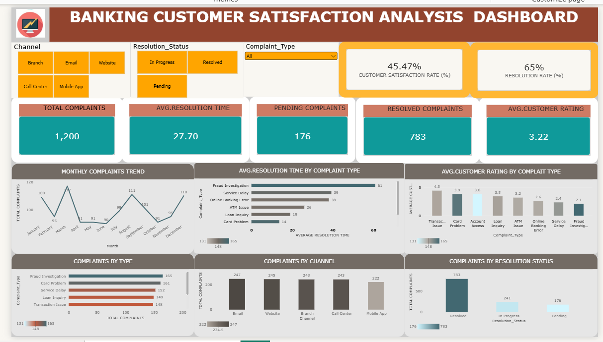

# Banking Customer Satisfaction Dashboard – Power BI

## Project Overview

This project focuses on analyzing banking customer complaints and satisfaction data using Microsoft Power BI. An interactive dashboard was developed to present customer satisfaction insights and complaint resolution information.

## Project Objectives

- Analyze banking customer complaints.
- Understand customer satisfaction levels.
- Evaluate customer ratings.
- Analyze complaint resolution status.
- Present insights through an interactive dashboard.

## Tools & Technologies

- Microsoft Power BI
- Power Query
- Data Visualization

## Key Analysis

- Customer Complaints
- Customer Ratings
- Complaint Resolution Status
- Customer Satisfaction Analysis

## Dashboard Preview

## Project Files

- `Banking_Customer_Satisfaction.pbix` – Power BI project file.
- `BANKING-CURSTONER-SATISFACTION-DASHBOARD.png` – Dashboard screenshot.

## Conclusion

The dashboard provides insights into banking customer complaints, satisfaction ratings, and complaint resolution status. It helps present customer feedback information in a clear and interactive format.
